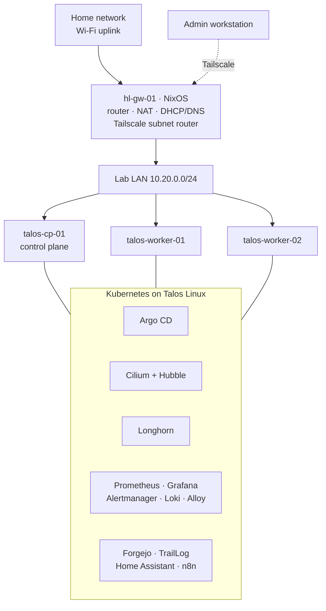
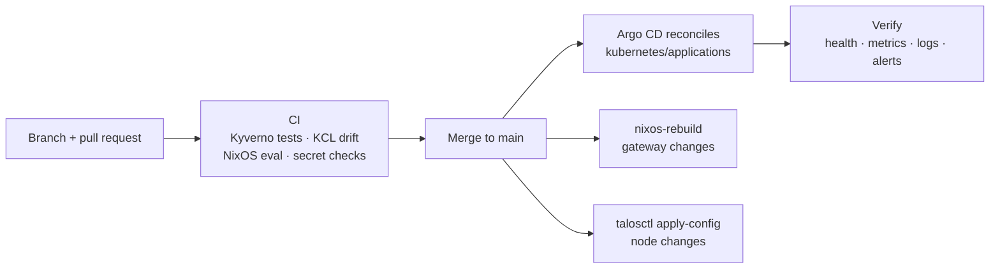

# homelab-platform

[](https://github.com/maciejlistos/homelab-platform/actions/workflows/ci.yaml)
[](LICENSE)

Declarative configuration for a small, real platform: a three-node **Talos Linux** Kubernetes cluster behind a **NixOS** gateway, reconciled by **Argo CD**, with policy checks, resource budgets, monitoring and logging.

It runs self-hosted services that I use every day, and it is where I practise platform engineering end to end: provisioning, GitOps, networking, storage, observability, guardrails and recovery.

> **Public mirror.** This repository is a sanitized copy of a private repository. Secrets, access endpoints and hardware identifiers are replaced with examples, and the Git history is fresh. It shows how the platform is built; it is not meant to be applied to your own hardware unchanged. See [SECURITY.md](SECURITY.md).

## Architecture



More detail: [architecture](docs/architecture.md), [network and access](docs/diagrams/network-and-access.md), [storage and data flow](docs/diagrams/storage-data-flow.md), and the [decision records](docs/adr/).

## What this demonstrates

| Area | How it is done here |
| --- | --- |
| Immutable infrastructure | Talos Linux nodes configured only through versioned machine-config patches and a pinned Image Factory schematic |
| Declarative hosts | The gateway is a NixOS flake: routing, NAT, dnsmasq, Tailscale, node exporter and journald shipping to Loki |
| GitOps | An Argo CD app-of-apps reconciles every platform component and application from `kubernetes/` |
| Networking | Cilium as CNI and kube-proxy replacement, L2 announcements for LAN load balancers, Hubble for flow visibility, ingress-restricting NetworkPolicies for exposed apps |
| Storage | Longhorn on dedicated user volumes, with backup and restore treated as separate from replication |
| Observability | kube-prometheus-stack, Loki and Grafana Alloy; alerts for the gateway, Longhorn, namespace budgets and CI runner pressure; an external heartbeat for the gateway |
| Policy as code | Kyverno `ValidatingPolicy` rules for privilege, escalation and resource requests, with Kyverno CLI tests that run in CI |
| Resource governance | `LimitRange` and `ResourceQuota` budgets per namespace, one of them generated with KCL and checked for drift in CI |
| CI/CD | A self-hosted Forgejo Actions runner on the cluster (`.forgejo/`), mirrored here as GitHub Actions (`.github/`) |
| Secrets | SOPS with age for host and cluster secrets, decrypted on the host by sops-nix; only example files are published |
| Platform APIs | Crossplane v2 with the Kubernetes provider, scoped to a lab namespace |

## Repository layout

```text
.
├── flake.nix, hosts/, modules/   NixOS gateway (hl-gw-01)
├── talos/                         Talos version, Image Factory schematic, per-node patches
├── kubernetes/
│   ├── bootstrap/                 Argo CD root Application (app of apps)
│   ├── applications/              One Argo CD Application per component
│   ├── platform/                  Helm values and manifests for platform components
│   ├── apps/                      Workloads, e.g. TrailLog
│   └── operations/                One-off operational Jobs, e.g. a restore
├── policies/kyverno/              Admission guardrails
├── tests/kyverno/                 Policy tests: compliant and non-compliant resources
├── esphome/                       Firmware config for a Bluetooth proxy
├── scripts/                       Helpers used by CI
├── secrets/, keys/                Example files only
└── docs/                          Architecture, diagrams, decision records, runbooks
```

## How a change reaches the cluster



Kubernetes changes are pulled by Argo CD. Gateway and node changes are applied deliberately by an operator, because a bad change there can cut off access to the cluster.

## Security model

- **No inbound exposure.** Nothing is port-forwarded from the home router. Remote access goes through Tailscale, and services are published to the tailnet by the Tailscale Kubernetes Operator.
- **Least privilege.** SSH is key-only for a single admin user; workloads run unprivileged, with explicit resource requests, unless an exception is documented and tested.
- **Secrets never in plaintext.** SOPS-encrypted files in the private repository; CI rejects plaintext secrets. This mirror ships placeholders.
- **Guardrails before deployment.** Policies are tested in CI against compliant and non-compliant fixtures before they are relied on.

## CI

| Check | What it does |
| --- | --- |
| Kyverno policies | Runs the policy test suite and validates Deployments against the guardrails |
| n8n chart audit | Renders the upstream Helm chart and audits it against the guardrails (report only) |
| TrailLog quota | Regenerates the namespace quota with KCL and fails on drift |
| NixOS evaluation | `nix flake check --no-build` for the gateway configuration |
| Secret scan | gitleaks plus a guard that fails if real endpoints, keys or ciphertext appear |

## Related repositories

- [traillog-app](https://github.com/maciejlistos/traillog-app): the Go web application deployed from `kubernetes/apps/traillog`.
- [sqlite-backup-operator](https://github.com/maciejlistos/sqlite-backup-operator): a Kubernetes operator for consistent SQLite backups, built for TrailLog.
- [platform-lab](https://github.com/maciejlistos/platform-lab): drills, SLOs and postmortems run against this platform.

## License

[Apache License 2.0](LICENSE).
