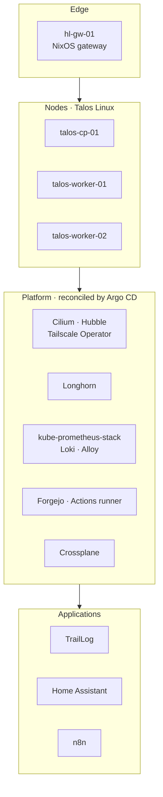

# Architecture

The HomeLab is a small platform that is run like a production one: everything is declared in Git, every change is reviewed and checked, and recovery is planned before it is needed. It supports learning, real self-hosted services, and safe experiments that do not compromise either.

## Layers

| Layer | Components | Managed by |
| --- | --- | --- |
| Edge | `hl-gw-01`: routing, NAT, DHCP/DNS, Tailscale subnet router, node exporter, journald to Loki | NixOS flake in this repository |
| Nodes | Three Talos Linux nodes, one control plane and two workers | `talos/` patches applied with `talosctl` |
| Platform | Networking, storage, observability, source control, CI runner, platform APIs | Argo CD, from `kubernetes/applications/` |
| Applications | TrailLog, Home Assistant, n8n | Argo CD, from `kubernetes/apps/` and `kubernetes/platform/` |

## Machines

| Machine | Role | Hardware | OS | Address |
| --- | --- | --- | --- | --- |
| `hl-gw-01` | Gateway | Dell Wyse 5070 thin client | NixOS 26.05 | `10.20.0.1` |
| `talos-cp-01` | Control plane, also schedulable for selected workloads | Intel Pentium Silver J5005, 4 cores, 8 GB | Talos Linux v1.13.9 | `10.20.0.10` |
| `talos-worker-01` | Worker | Intel Celeron N4100, 4 cores, 8 GB | Talos Linux v1.13.9 | `10.20.0.20` |
| `talos-worker-02` | Worker | Dell OptiPlex 3000, Intel Celeron N5105, 4 cores, 16 GB | Talos Linux v1.13.9 | `10.20.0.30` |

Low-power, second-hand mini PCs on purpose: resource limits are real, so requests, quotas and capacity planning matter.

## Gateway

The gateway joins the home Wi-Fi network as a client and routes a separate wired lab LAN behind it. This keeps the lab independent of the home router: the lab has its own addressing, DHCP, DNS (`lab.home.arpa`) and firewall, and needs no changes on the router.

- **Uplink:** Wi-Fi with DHCP; the pre-shared key is a SOPS secret rendered at activation by sops-nix.
- **LAN:** `10.20.0.0/24` on Ethernet, with static DHCP reservations for the nodes.
- **Routing:** nftables NAT from the LAN to the uplink.
- **Remote access:** Tailscale advertises `10.20.0.0/24` as a subnet route, so the admin workstation reaches the Talos and Kubernetes APIs without any port forwarding.
- **Observability:** node exporter for Prometheus, journald shipped to Loki by Grafana Alloy, and a heartbeat to an external service so that a dead gateway still raises an alert.

## Kubernetes

- **Talos Linux** with a pinned [Image Factory](../talos/image-factory/schematic.yaml) schematic that adds the iSCSI and util-linux extensions that Longhorn needs. There is no SSH on the nodes; configuration changes go through the Talos API. See [ADR 0001](adr/0001-talos-linux-for-kubernetes-nodes.md).
- **Cilium** is the CNI and replaces kube-proxy. L2 announcements give LAN-reachable load-balancer IPs, and Hubble shows flows when debugging network policy. See [ADR 0002](adr/0002-cilium-as-cni-and-kube-proxy-replacement.md).
- **Longhorn** stores persistent volumes on dedicated user volumes on each node. Replication protects against a node failure; it is not a backup.

## GitOps

Argo CD runs an app-of-apps: [`kubernetes/bootstrap/root-app.yaml`](../kubernetes/bootstrap/root-app.yaml) points at `kubernetes/applications/`, where each component has one `Application`. Upstream charts are pinned to exact versions and combined with local values and manifests through multi-source Applications.

| Component | Chart version |
| --- | --- |
| Argo CD | `argo-cd` 10.4.1 |
| Cilium | 1.20.2 |
| Longhorn | v1.12.1 |
| kube-prometheus-stack | 89.2.0 |
| Loki | 18.13.0 |
| Grafana Alloy | 1.11.0 |
| Tailscale Operator | 1.102.3 |
| Forgejo | 17.1.5 |
| Crossplane | 2.4.0 |
| metrics-server | 3.14.0 |
| n8n | 1.11.0 |

## Access

Nothing is exposed to the internet. Services are published to the private tailnet through the Tailscale Kubernetes Operator (`ingressClassName: tailscale`), and Kubernetes API access for the admin is granted through Tailscale identity. Forgejo additionally has a LAN load-balancer address so that the nodes can pull images from its registry. See [network and access](diagrams/network-and-access.md) and [ADR 0003](adr/0003-private-access-through-tailscale.md).

## Observability

- Metrics: Prometheus, scraping the gateway's node exporter plus ServiceMonitors for Longhorn, Home Assistant and n8n.
- Logs: Loki, fed by Grafana Alloy from the cluster and from the gateway's journal.
- Alerts: gateway down, gateway disk and critical services, Longhorn volumes degraded, faulted or nearly full, Home Assistant down, namespace budgets nearly full, CI runner memory pressure, OOM kills and node disk pressure.
- Dashboards: provisioned from JSON in Git.

Alerts are kept actionable: each one has a clear owner action, and noisy ones are tuned or removed.

## Guardrails

- **Admission policy:** Kyverno `ValidatingPolicy` rules require unprivileged containers, disabled privilege escalation, and CPU and memory requests with a memory limit. The CI runner has a narrowly scoped, tested exception because Docker-in-Docker needs privilege.
- **Resource budgets:** namespaces get a `LimitRange` and a `ResourceQuota`. TrailLog's quota is generated from KCL and CI fails if the committed output drifts.
- **CI:** every change to `main` goes through a pull request with a required check. See the [CI table](../README.md#ci).
- **Network policy:** exposed applications such as Forgejo and n8n accept ingress only from the expected sources.

## Storage and recovery

See [storage and data flow](diagrams/storage-data-flow.md). Principles:

- Replication is availability, not backup.
- A backup counts only once a restore has been tested.
- Stateful changes start with a recovery plan.

TrailLog stores its data in SQLite. A sidecar takes consistent online backups to a separate volume, and [`kubernetes/operations/traillog/restore.yaml`](../kubernetes/operations/traillog/restore.yaml) is the tested restore Job.

## Principles

- Boring, maintainable infrastructure over clever abstractions. See [ADR 0004](adr/0004-keep-ci-as-plain-workflows.md).
- Declarative configuration and GitOps.
- Small, reversible changes with a rollback plan for risky ones.
- Least privilege: no broad RBAC or privileged containers without a documented reason.
- Verify with logs, metrics and runtime checks, not only a successful sync.
