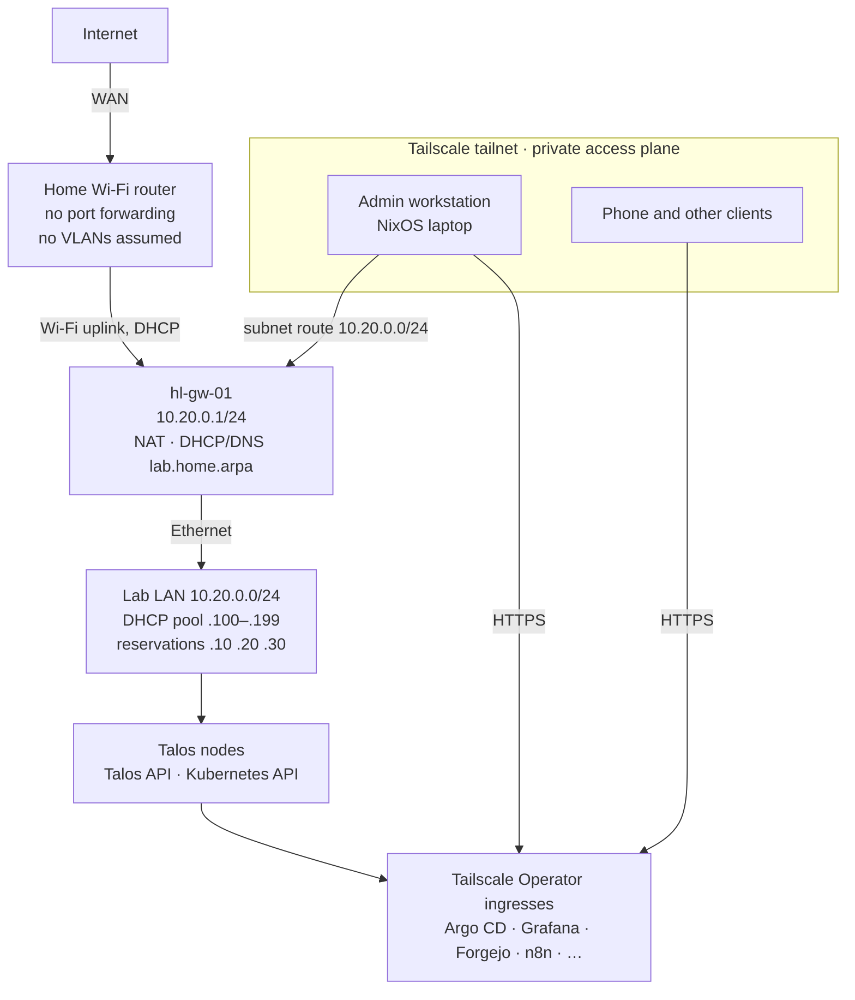

# Network and access

## Rules

| Rule | Why |
| --- | --- |
| No inbound port forwarding on the home router | Nothing in the lab is reachable from the internet |
| Remote access only over Tailscale | One authenticated, encrypted access plane, governed by tailnet ACLs |
| Talos and Kubernetes APIs reached through the gateway's subnet route | Nodes stay off the tailnet; the gateway is the single entry point |
| Applications published with `ingressClassName: tailscale` | Each service gets its own tailnet hostname and TLS certificate |
| Kubernetes admin rights bound to a Tailscale identity | No long-lived kubeconfig credentials have to be handed out for remote use |
| SSH on the gateway: keys only, one admin user, no root login | Smallest useful attack surface |

## Addressing

| Range or host | Use |
| --- | --- |
| `10.20.0.1` | Gateway |
| `10.20.0.10`–`10.20.0.30` | Talos nodes, static DHCP reservations |
| `10.20.0.50` | Forgejo LAN load balancer (Cilium L2 announcement), used by nodes to pull images |
| `10.20.0.100`–`10.20.0.199` | DHCP pool |
