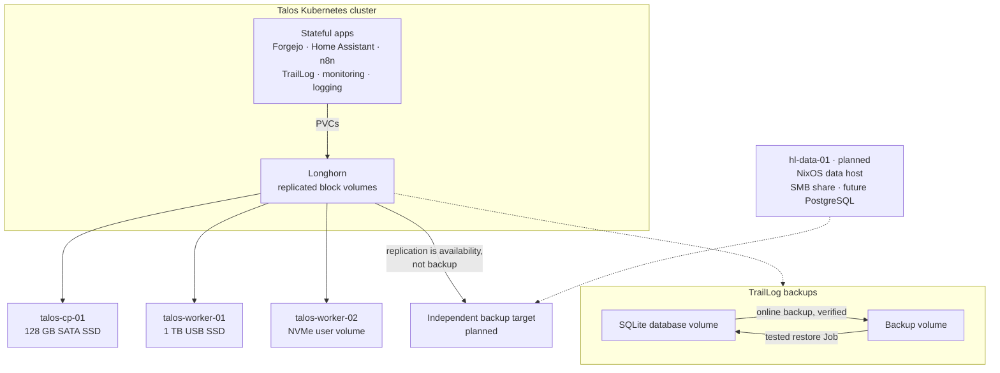

# Storage and data flow

## Principles

- **Replication is not backup.** Longhorn keeps replicas on different nodes, which survives a node failure, but not deletion, corruption or a bad change.
- **Backups count once restored.** Each backup path needs a restore test before the data it protects is considered safe.
- **Same-disk copies are not backups.** A copy on the same SSD fails with that SSD.
- **Stateful changes start with a recovery plan.** Check backups and know the rollback before changing a persistent workload.

## Current and planned

| Item | State |
| --- | --- |
| Longhorn on dedicated user volumes on all three nodes | Running |
| TrailLog SQLite backup sidecar, verification and restore Job | Running |
| Consistent SQLite backups as a Kubernetes operator | sqlite-backup-operator (In progress) |
| `hl-data-01` NixOS data host with an SMB share | Planned |
| Independent off-cluster backup target | Planned |
